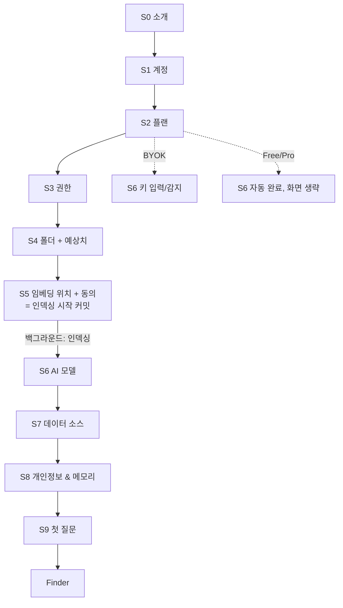

# 신규 사용자 온보딩 기획 (초안)

상태: 기획 단계. 구현은 아직 하지 않는다. 브랜치는 `feat/onboarding-plan`.

## 0. 원칙

1. **설정이 생기는 건 UX 실패의 결과다.** 질문은 기본값을 만들 수 없을 때만 한다.
2. **되돌릴 수 없는 결정만 멈춰서 확인한다.** 되돌릴 수 있는 결정은 기본값을 쓰고 Settings에서 바꾸게 둔다.
3. **감지 > 질문.** 환경에 이미 있는 것(API 키, 설치된 CLI, Obsidian vault, 기존 AutoRAG config)은 찾아서 "이걸 쓸까요?"로 확인만 받는다.
4. **사용자가 클릭하는 동안 기계는 일한다.** 무거운 작업(바이너리 준비, 모델 다운로드, 인덱싱)은 커밋 시점 직후 백그라운드에서 시작하고, 이후 화면은 그 시간을 활용한다.
5. **첫 가치는 빠르게.** 온보딩은 투어가 아니라 "첫 질문에 답을 받는 것"으로 끝난다.

목표 사용자 시간: 플랜 경로 3분 이하, BYOK 경로 5분 이하 (인덱싱 대기 시간 제외).

## 1. 현재 상태 (근거)

| 영역 | 지금 | 근거 |
|---|---|---|
| 첫 실행 / 온보딩 | 없음. 바로 Finder 창이 뜬다 | `src/main/index.ts` |
| 계정 / 플랜 / 결제 | 앱과 librarian 모두 코드 없음 | 앱 전체, librarian `src/` |
| 인덱싱 루트 | config가 없으면 `searchPaths: [process.cwd()]`. 배포 앱에서는 사실상 엉뚱한 폴더 | `src/main/index.ts:51-53` |
| 루트 추가/삭제 UI | 없음. 파일 단위 제외만 있음 (컨텍스트 메뉴 → `excludePaths`) | `src/main/index-status.ts` |
| 인덱싱 진행률 UI | 없음. librarian은 `.autorag/refresh-progress.json`에 phase와 count를 남긴다 | librarian `src/agent/refresh-progress.ts` |
| 임베더 | 기본은 로컬 llama.cpp `qwen3-embedding-0.6b` (1024d). 대안은 `embeddinggemma-300m` (768d). 원격은 `minSync.embedder.baseUrl` | librarian `src/embedding-runtime/manifest.ts` |
| 임베더 변경 | identity(provider, model, artifactRevision, dimension, prefix, **runtimeBuild**)가 하나라도 바뀌면 `sync --full`. 쿼리는 reindex 전까지 throw | librarian `src/minsync/client.ts:293-297,349-356` |
| LLM | config `model` 하나뿐. 키는 env(`apiKeyEnv`)에서만 읽는다. 없으면 `~/.codex/config.toml`로 fallback | librarian `src/cli/config.ts` |
| 키 저장 | Keychain / `safeStorage` 없음 | 앱 전체 |
| Models 화면 | 읽기 전용 진단 화면. 입력 필드 없음 | `SettingsView.tsx` |
| 데이터 소스 | 16종. 대부분 외부 CLI(`slacrawl`, `lazykatok`, `notcrawl`, `rclone`…)가 PATH에 있고 따로 인증까지 돼 있어야 함. 설명(`description`) 필드는 이미 있음 | librarian `src/datasource/skills/factory.ts`, `src/main/datasource-status.ts` |
| 메모리 | `RetrievalMemory`: 검색 학습용(쿼리, 요약, 피드백). 쿼리와 요약은 평문 JSON. on/off 토글 없음 | librarian `src/memory/memory.ts` |
| macOS 권한 (TCC / FDA) | 처리 코드 없음 | 앱 전체 |
| 보조 바이너리 | minsync와 jikji는 `cargo install`로 자동 설치. 일반 사용자 머신에는 cargo가 없다 | librarian `src/jikji/installer.ts`, `minSync.autoInstall` |

## 2. 결정 분류

### A. 반드시 묻는다 (되돌릴 수 없거나 비용·프라이버시가 걸린 것)

| 항목 | 이유 | 기본값 |
|---|---|---|
| 계정 | 플랜, 체험판, 원격 처리 인증 | Apple / Google / 이메일 매직링크 |
| 플랜 (Free / Pro / BYOK) | 임베딩·LLM 경로를 한 번에 결정하는 마스터 스위치 | 체험판이 붙은 Pro 또는 Free (§7 결정 필요) |
| 인덱싱 폴더 | AI가 볼 수 있는 범위이자 인덱싱 시간을 정한다 | Documents + Desktop (+ iCloud Drive/Documents) |
| 임베딩 위치 (로컬 / 클라우드) | 바꾸면 전체 reindex. 클라우드는 본문이 외부로 나감 | 플랜에 따름 (§3 S4) |
| 원격 전송 동의 | 클라우드 임베딩·LLM 사용 시 법적·신뢰 문제 | 명시적 동의 체크 |

### B. 감지해서 확인만 받는다

| 항목 | 감지 방법 |
|---|---|
| BYOK 키 | env의 `OPENAI_API_KEY`, `ANTHROPIC_API_KEY`, `OPENROUTER_API_KEY`, `GEMINI_API_KEY`; `~/.codex/config.toml`; `127.0.0.1:11434` Ollama |
| 데이터 소스 | `BACKEND_BINARIES` PATH probe, `GITHUB_TOKEN` / `gh auth status`, Obsidian vault 목록, `~/Library/Mail`, Spotlight(macOS 기본 제공) |
| 기존 AutoRAG 사용자 | 공유 config 파일 존재 + `searchPaths`/`model` 설정 여부 → 해당 단계 건너뜀 |
| 인터페이스 언어 / 검색 언어 | OS locale → `language`, `languages` |
| 화면 모드 | OS 다크모드 → `appearance` |

### C. 기본값을 쓰고 묻지 않는다 (Settings에서만 변경)

`minSync` 켜짐, `jikji` 켜짐(`writeAgentRules: false`), `dupey` 켜짐 + `excludeExactDuplicates`, OCR 꺼짐, `webSearch` 켜짐, `p2p` 꺼짐, `everything`(Windows에서만 켜짐), 청크 크기, 임베더 batch/timeout/concurrency, `workspacePath`와 `memoryPath`(앱 데이터 폴더로 고정, §6), dupey 스캔 주기, 숨김 파일, 메뉴바, 자동 업데이트, 보기 모드.

### D. 온보딩에서 뺀다 (나중에 맥락 안에서 묻는다)

- **OCR**: 스캔 PDF나 이미지 비율이 높을 때만 "스캔 문서가 많아요. OCR을 켤까요?" 배너를 띄운다.
- **CLI 기반 데이터 소스 설치·인증** (Slack, Kakao, Notion…): 온보딩에서는 이미 준비된 것만 켠다. 설치는 Settings → Data Sources의 가이드로 보낸다.
- **세부 모델 슬롯** (fast, vision 등): librarian에는 지금 `model` 하나뿐이다. 슬롯이 생겨도 추천 모델을 자동 배정하고 Settings에서만 바꾸게 한다.
- **P2P, 세부 경로 권한(`permissions`) 설정**.

## 3. 플로우

모든 단계는 상태를 디스크에 저장한다. 중간에 앱을 끄거나 macOS가 권한 적용을 위해 앱을 재시작해도 같은 단계에서 다시 시작한다. 뒤로 가기는 S5 커밋 전까지만 자유롭다. 커밋 후 폴더나 임베딩을 바꾸면 "인덱싱을 다시 시작합니다" 확인을 띄운다.

모든 단계는 상태를 디스크에 저장한다. 중간에 앱을 끄면 같은 단계에서 다시 시작한다. 뒤로 가기는 S4 커밋 전까지만 자유롭다. 커밋 후 폴더나 임베딩을 바꾸면 "인덱싱을 다시 시작합니다" 확인을 띄운다.

### S0. 소개 (1화면)

- Raycast 예시처럼 왼쪽에 한 줄 가치 제안 + 체험판 배지, 오른쪽에 기능 카드 4~6개 그리드. 하단에 진행 점과 Continue.
- 카드 후보: AI 검색(내 파일에 묻기), 근거 인용, 버전 묶기(dupey), Quick Look, 데이터 소스, 로컬 우선 프라이버시.
- 슬라이드 여러 장으로 만들지 않는다. 한 화면, 한 번 클릭.
- **백그라운드**: 시스템 점검. 플랫폼 확인, 디스크 여유 공간, 번들 바이너리(minsync, jikji, dupey, llama-server) 확인과 준비를 시작한다.

### S1. 계정

- 브라우저 OAuth(Apple, Google, 이메일 매직링크) → 커스텀 URL 스킴 딥링크로 앱에 돌아온다. 앱 안에 비밀번호 입력 폼을 두지 않는다.
- 이미 로그인된 기기면 자동으로 건너뛴다.
- 실패, 오프라인: 재시도 + "오프라인으로 계속(BYOK 전용)" 노출 여부는 §7 결정에 따른다.

### S2. 플랜

카드 세 장, 각 카드에 "무엇이 원격으로 가는지" 한 줄을 붙인다.

| | Free | Pro | BYOK |
|---|---|---|---|
| LLM | 우리 서버(쿼터) | 우리 서버(넉넉함) | 사용자 키 |
| 임베딩 | 로컬(또는 쿼터 내 클라우드) | 클라우드 또는 로컬 | 로컬 |
| 설정량 | 0 | 0 | 키 + 모델 |

- 플랜은 이 화면에서 **한 번만** 고른다. 이후 임베딩·LLM 단계는 플랜에서 파생되므로 같은 질문을 반복하지 않는다.
- 결제는 체험판으로 시작하고, 결제 수단 입력은 체험이 끝날 때 받는다 (온보딩 이탈 방지).

### S3. 권한 (macOS)

- 폴더 사전 스캔 전에 권한 상태를 확인한다. 권한과 인덱싱 범위는 별개이며, AI가 읽는 범위는 다음 단계에서 사용자가 직접 고른다.
- **전체 디스크 접근**은 Mail, 메시지 보관함, `~/Library`, 보호된 앱 데이터와 외장 디스크를 한 번에 읽는 **강력 권장** 항목이다. 앱에서 직접 허용할 수 없으므로 System Settings로 deep-link하고, 복귀 시 protected-path read probe로 상태를 재확인한다.
- macOS가 권한 적용을 위해 앱 재시작을 요구하면 현재 onboarding step과 선택값을 저장한 뒤 종료·재실행하고 같은 단계로 복귀한다. prototype은 System Settings 목업, 토글, "종료 후 다시 열기" 시트를 제공한다.
- 전체 디스크 접근을 건너뛰면 선택한 일반 폴더는 Files & Folders TCC prompt로 개별 허용한다. Mail, 메시지, 일부 `~/Library` 데이터와 외장 볼륨은 연결할 수 없다는 제한을 먼저 보여준다.
- 알림은 인덱싱 완료·오류 알림용 선택 권한이며, `launchAtLogin`은 백그라운드 인덱스 유지용 토글이다. Accessibility, Screen Recording, Contacts, Calendar, Microphone, Camera 권한은 요청하지 않는다.

### S4. 인덱싱 폴더

- 기본 체크: `~/Documents`, `~/Desktop`, (있으면) `iCloud Drive/Documents`. 기본 해제로 노출: `~/Downloads`(잡음 많음), 연결된 클라우드 드라이브. 후보 목록은 사이드바 places(`src/main/places.ts`)를 재사용한다.
- 각 행에 **실시간 예상치**: 인덱싱 대상 파일 수, 용량, 예상 소요 시간(로컬과 클라우드 각각). 빠른 사전 스캔을 쓴다. librarian 스킵 규칙(`node_modules`, `.git`, 50 MiB 초과 등)과 파서 지원 확장자를 그대로 적용해서 실제 대상만 센다.
- 가드레일: 홈 폴더 전체, 볼륨 루트, `~/Library`를 고르면 경고와 예상치를 강조한다. 예상 시간이 임계치(예: 로컬 2시간)를 넘으면 하위 폴더를 제안하고, 같은 트리가 겹치면 자동으로 합친다.
- "폴더 추가"는 `dialog.showOpenDialog`로 받는다. macOS TCC prompt가 언제 뜨는지 미리 한 줄로 안내한다.
- 문구: "여기 있는 파일만 AI가 읽습니다. 언제든 추가하거나 뺄 수 있어요." 폴더는 되돌릴 수 있는 결정이다.
### S5. 임베딩 위치 + 동의 → 인덱싱 시작 (커밋 지점)

- 선택지는 두 개뿐이다. 모델 이름은 숨긴다.
  - **이 Mac에서 (로컬)**: 비공개. 예상 N시간. 모델 다운로드 약 0.6 GB [INFERENCE: Q8_0 0.6B 기준 크기, 실측 필요]. 노트북은 전원 연결 권장.
  - **클라우드에서 (Free 쿼터 / Pro)**: 빠름. 예상 M분. 파일 본문이 처리용으로 전송되고, 저장하지 않는다는 문구와 링크.
- 기본값: Pro → 클라우드, Free/BYOK → 로컬. 단, S3 예상치가 임계치를 넘으면 클라우드를 추천 표시만 한다.
- "나중에 바꾸면 전체를 다시 인덱싱합니다"를 명시한다.
- 클라우드를 고르면 원격 전송 동의 체크가 필수다.
- 버튼은 "인덱싱 시작". 누르는 순간 config(`searchPaths`, `workspacePath`, `minSync.embedder`)를 쓰고 refresh를 시작한다.
- 로컬 프로필 선택(Qwen3 대 Gemma)은 노출하지 않는다. 저사양(RAM 8 GB 이하)이면 `embeddinggemma-300m`을 자동으로 고른다 [INFERENCE: 임계치는 벤치 필요].

### S6. AI 모델

- **Free / Pro**: 화면을 생략하거나, 체크 표시만 0.5초 보여주고 넘어간다.
- **BYOK**:
  1. 감지 결과를 먼저 보여준다: "환경에서 `ANTHROPIC_API_KEY`를 찾았어요 / Ollama 실행 중 / Codex 설정 발견 → 사용".
  2. 없으면 provider 선택(OpenRouter, Anthropic, OpenAI, Google, Ollama, OpenAI 호환 URL) → 키 붙여넣기 → **즉시 검증**(작은 completion 호출) → 추천 모델 자동 선택.
  3. 모델 목록, `contextWindow`, `reasoning` 같은 세부 항목은 "고급"에 접어 둔다.
- 키는 Keychain(`safeStorage`)에 저장하고, 실행 시 `providerApiKeys`로 주입한다. config에는 절대 쓰지 않는다 (librarian 원칙과 일치).
- 화면 상단에는 인덱싱 진행 pill이 항상 보인다.

### S7. 데이터 소스

- **준비된 것만** 목록에 올린다: CLI가 설치·인증된 것, `gh` 인증된 GitHub, 발견된 Obsidian vault, Apple Mail, Spotlight. 기본은 꺼짐이고 토글 한 번으로 켠다.
- 설명(`description`)은 **미리 채운 초안**으로 제공한다.
  - 1차: 소스 유형별 템플릿 ("회사 Slack. 프로젝트 논의와 결정 사항").
  - 2차(선택): 켠 뒤 메타데이터만 샘플링(채널명, 폴더명, 메일 제목)해서 LLM으로 초안을 만든다. 본문은 보내지 않는다.
  - 사용자는 수정만 한다. 빈칸에서 직접 쓰게 하지 않는다.
- 준비 안 된 소스: "더 연결하기 → Settings"로 보낸다. 온보딩에서 CLI 설치를 안내하지 않는다.
- 켜면 `datasourceAccess.allowedTags`에도 반영한다 (librarian 기본값이 default-deny).
- 이 단계 전체를 건너뛸 수 있다.

### S8. 개인정보 & 메모리 (토글 한 화면)

| 토글 | 기본 | 설명 문구 |
|---|---|---|
| 검색 메모리 | 켜짐 | "검색할수록 더 잘 찾도록 질문과 요약을 이 Mac에 저장합니다" |
| 진단 정보 공유 | 꺼짐 | opt-in. GDPR 기준 |

- 로그인 시 실행은 S3 권한 단계에서 처리한다. 개인정보 단계에서는 검색 메모리와 진단 정보만 묻는다.

- 메모리 정의는 §7에서 결정한다. 지금 librarian 메모리는 검색 학습용이지 Raycast식 "프로필 메모리"(사용자 사실 기억)가 아니다.

### S9. 첫 질문 (기능 투어 대체)

- AI 검색 탭을 열고, 인덱싱된 폴더 이름과 최근 파일로 만든 **추천 질문 3개**를 보여준다. 클릭하면 바로 실행된다.
- 인덱싱이 아직 진행 중이면: jikji와 파일명 검색은 즉시 동작한다는 점을 알리고, 부분 인덱스로 답하면서 "인덱싱 42% — 결과가 늘어납니다"를 표시한다.
- 코치마크 3개 이하, 각각 실제 UI에 고정: (1) 파일 행의 인덱스 상태 점과 우클릭 "AI 검색에서 제외", (2) 파일·폴더를 AI 검색에 드래그, (3) Settings 위치.
- 슬라이드형 투어는 만들지 않는다.

### 프로토타입 레퍼런스

- 정적 HTML 목업: [`docs/design-reference/onboarding/onboarding-prototype.html`](design-reference/onboarding/onboarding-prototype.html)
- 실행: `python3 -m http.server 4177`을 `docs/design-reference/onboarding/`에서 실행한 뒤 브라우저로 `onboarding-prototype.html`을 연다.
- 포함 상태: Light/Dark, Free/Pro/BYOK 시나리오, 10단계 점프, Full Disk Access System Settings 목업, 재시작 후 권한 복귀, 폴더 선택·ETA, 임베딩 동의·인덱싱 pill, BYOK 검증, 데이터 소스 토글, 메모리 토글, 첫 질문 목업.

## 4. 백그라운드 작업 타임라인

```mermaid
gantt
  dateFormat X
  axisFormat %s
  section 사용자
  S0-S2 소개·계정·플랜 :u1, 0, 60
  S3 권한·S4 폴더 :u2, after u1, 45
  S5 임베딩·S6 모델·S7 소스·S8 개인정보·S9 첫 질문 :u3, after u2, 90
  section 기계
  바이너리 준비 :m1, 0, 40
  사전 스캔(S3 진입 시) :m2, 60, 20
  로컬 모델 다운로드(S2에서 로컬 확정 시) :m3, 60, 60
  인덱싱(parsed→minsync→datasources→jikji) :m4, after u2, 600
```

- 로컬 모델 다운로드는 S2에서 로컬 경로가 확정되면 바로 시작한다 (S5 대기 X). 클라우드를 고르면 취소한다.
- 인덱싱은 앱 전체 상태로 승격한다. 온보딩이 끝나도 툴바나 사이드바에 진행률이 남는다.
- 인덱싱 중에는 `powerSaveBlocker`로 잠자기를 막고, 배터리 모드에서는 속도를 낮추며, 일시정지·재개를 지원한다. 재개는 librarian 체크포인트(25파일마다 mirror flush, minsync cursor)로 이미 가능하다.

## 5. 원안 대비 변경점

| 원안 | 변경 | 이유 |
|---|---|---|
| 임베딩 단계에서 free/paid 선택 | 플랜은 S2에서 한 번만 | 플랜이 임베딩과 LLM을 둘 다 결정한다. 두 번 묻지 않는다 |
| 폴더 → 임베딩 | 유지하되 S3에 시간 예상치를 넣고, S4를 커밋 지점으로 만든다 | "신중하게"를 숫자로 보여줘야 신중해진다 |
| 인덱싱하며 LLM 설정 | 유지. 플랜 사용자는 화면 자체를 생략 | 딸깍조차 없앤다 |
| 데이터 소스 자동 인식 + 설명 직접 입력 | 준비된 것만 노출 + 설명은 초안 제공, 수정만 | CLI 미설치 소스는 일반 사용자에게 막다른 길이다. 빈칸 작성은 이탈 요인 |
| 메모리 활성화 단독 질문 | 개인정보 토글 화면에 합침 | 결정 하나에 화면 하나는 과하다 |
| 기능 투어 | 첫 질문 + 코치마크 3개 | 투어는 스킵되고, 첫 답변이 가치를 증명한다 |
| (없음) | S0 백그라운드 시스템 점검, TCC 처리, 기존 config 감지, 재개 가능한 상태 | 실제로 막히는 지점들 |

## 6. 구현 전에 필요한 것 (갭)

### 앱

1. 온보딩 상태 저장(`onboarding: { step, completedAt, version }`)과 첫 실행 분기 (`src/main/index.ts`).
2. `ensureAutoRAGConfig`의 `process.cwd()` 기본값을 제거한다. `workspacePath`는 앱 데이터 폴더로, `searchPaths`는 온보딩에서 받는다.
3. 키 저장: `safeStorage`/Keychain → `providerApiKeys` 주입. Models 화면을 읽기 전용에서 편집 가능으로 바꾼다.
4. 인덱싱 진행률 서비스: `refresh-progress.json`을 watch해서 bridge로 push한다. 브리지 계약은 shared, IPC, preload, 두 소스 어댑터에 동시에 반영해야 한다 (AGENTS.md).
5. 사전 스캔 API: 폴더별 대상 파일 수, 용량, ETA.
6. 데이터 소스 감지 API (현재 `datasource-status.ts`의 probe 확장).
7. `launchAtLogin` → `app.setLoginItemSettings` 실제 연결.
8. 계정 / 플랜 / 딥링크 / 체험판: 서버를 포함해 전부 신규.
9. 보조 바이너리 번들링: cargo 의존 제거 (minsync, jikji, dupey, llama-server).

### librarian (공개 저장소에 PR)

1. 진행률 스키마에 `minsync: { total }`과 ETA 계산 근거 추가 (지금은 `synced`만 있음).
2. 메모리 on/off 옵션 (`memory: false`).
3. 클라우드 임베더 provider (우리 서버 인증 방식).
4. **임베딩 identity의 `runtimeBuild`**: llama.cpp 런타임만 업그레이드돼도 전체 reindex가 일어난다. 앱 업데이트 한 번에 사용자 전원이 재인덱싱하게 되므로, 온보딩과 무관하게 해결해야 한다.
5. (선택) 최근 수정 파일 우선 인덱싱: 첫 답변까지의 시간 단축.

## 7. 열린 결정

1. **원격 임베딩과 저장소 규칙의 충돌.** AGENTS.md에 "Do not send corpus text to remote embedders"가 있다. 클라우드 임베딩은 이 규칙을 정면으로 바꾸는 제품 결정이다. 오너 승인과 AGENTS.md 개정이 필요하다.
2. **로그인 필수 여부.** BYOK + 로컬 사용자에게도 계정이 필요한가? 필수로 하면 라이선스와 체험판 관리가 단순해지고, 선택으로 하면 로컬 우선 신뢰와 활성화율이 올라간다.
3. **Free 플랜 범위.** 클라우드 임베딩을 쿼터 안에서 포함할지, 로컬만 줄지.
4. **"되돌릴 수 없음" 자체를 없앨지.** 클라우드에서 로컬과 같은 모델(Qwen3-Embedding-0.6B)을 서빙하고 identity를 모델 기준으로 완화하면 로컬↔클라우드 전환에 reindex가 필요 없어질 수 있다. 다만 양자화 차이(Q8 대 fp16)로 생기는 벡터 드리프트를 검증해야 한다 [INFERENCE]. 성공하면 S4의 "신중하게"가 사라진다. 원칙 1에 가장 잘 맞는 방향이다.
5. **메모리의 정의.** 검색 학습 메모리(현재)인가, Raycast식 사용자 프로필 메모리(신규 기능)인가.
6. **모델 슬롯.** BYOK에서 "온갖 모델"이 구체적으로 무엇인가(메인, 빠른, 비전, 임베딩?). librarian은 지금 `model` 하나다.

## 8. 지표

- 단계별 이탈률, 단계별 소요 시간.
- 온보딩 완료 → 첫 질문까지의 시간, 첫 질문의 인용 클릭률.
- 선택된 폴더의 파일 수와 실제 인덱싱 시간 (예상치 보정용).
- 임베딩 선택 분포, 7일 내 임베딩 변경률.
- 데이터 소스 연결률, 설명 초안 수정률.

텔레메트리는 opt-in이다. 동의하지 않은 사용자는 로컬 집계만 한다.
